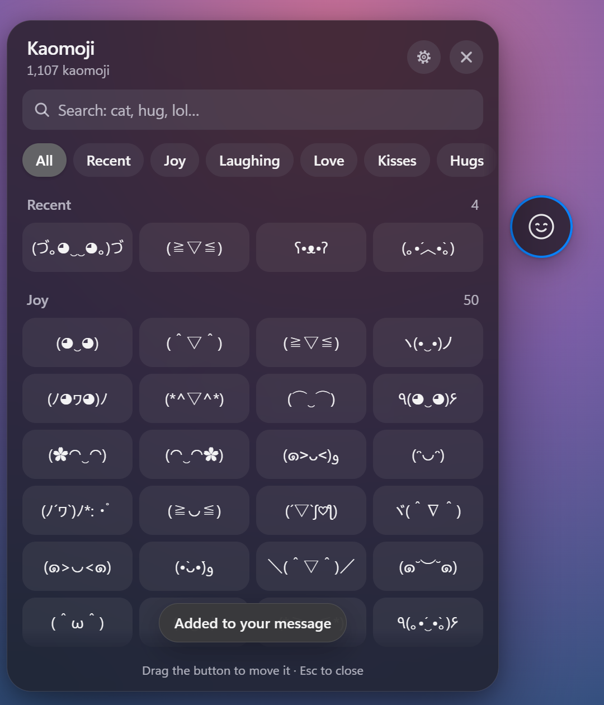
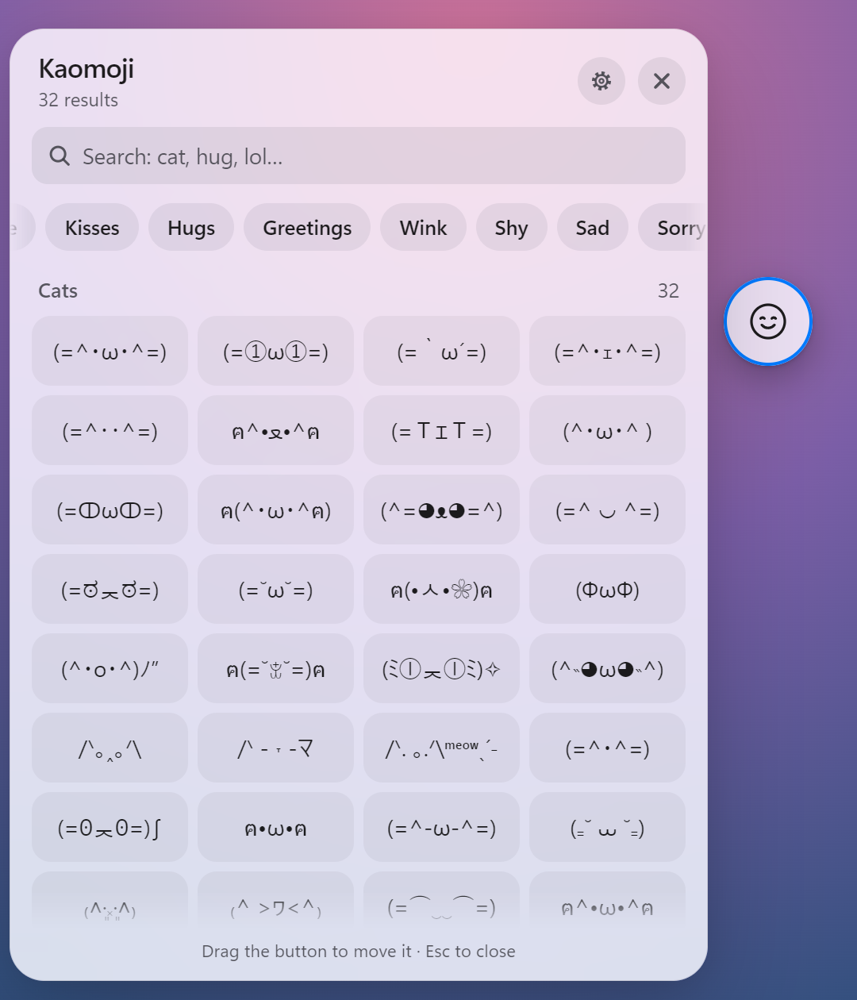
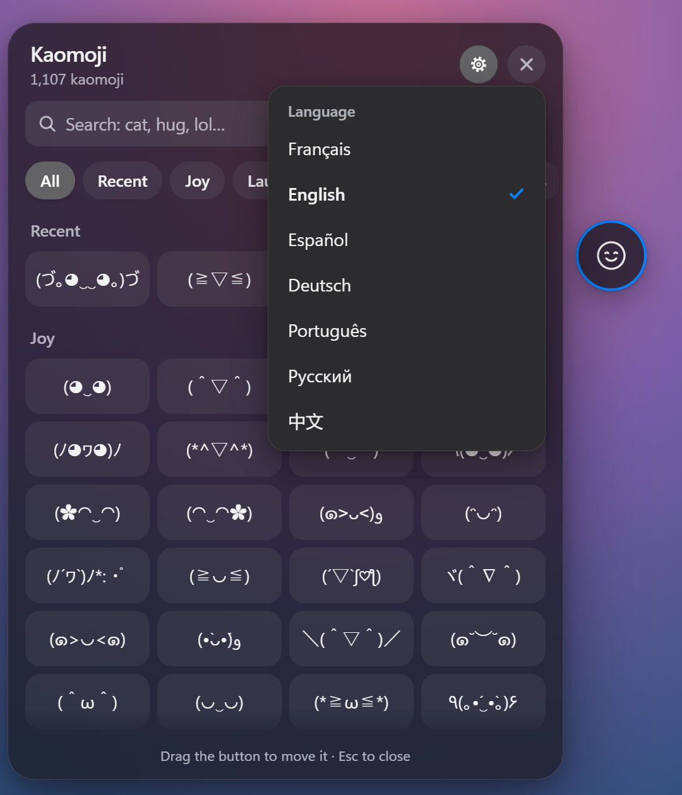
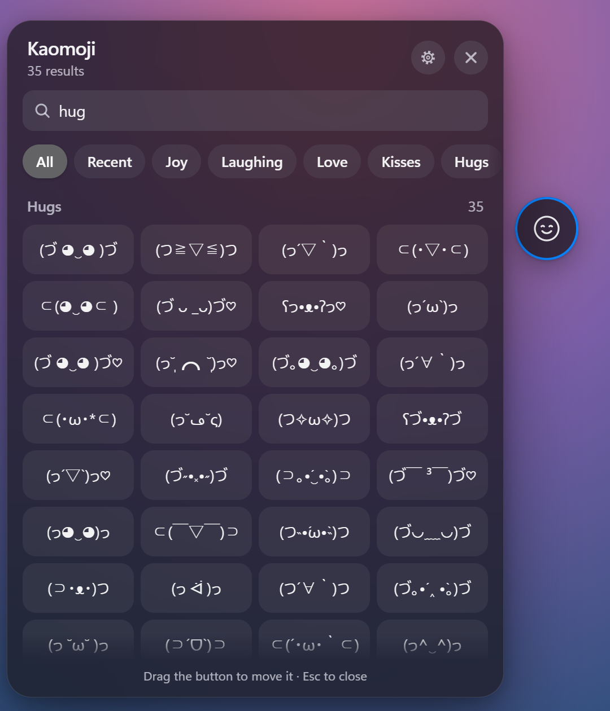

# BC Kaomoji

A draggable kaomoji panel for the Bondage Club chat. Click an expression and it is inserted at the cursor in your chat box, without sending the message.

<p align="center">
  
  
</p>

### TamperMonkey install:
**Stable:**
https://github.com/Stro0dle/bc-kaomoji/raw/main/bcKaomojiLoader.user.js

**Dev:**
https://github.com/Stro0dle/bc-kaomoji/raw/dev/bcKaomojiLoader-dev.user.js

Install [Tampermonkey](https://www.tampermonkey.net/), open one of the links above and click **Install**. Then open or reload Bondage Club and join a chat room. Install only one of the two.

### Bookmark:
**Stable:**
```
javascript:(()=>{fetch('https://stro0dle.github.io/bc-kaomoji/bundle.js').then(r=>r.text()).then(r=>eval(r));})();
```
**Dev:**
```
javascript:(()=>{fetch('https://stro0dle.github.io/bc-kaomoji/dev/bundle.js').then(r=>r.text()).then(r=>eval(r));})();
```

## Features

- **1,100+ kaomoji** in 35 categories: joy, love, hugs, greetings, shy, sad, angry, smug, table flips, sleep, magic, food, cats, dogs, bears, bunnies and more.
- **Search** by category name in any supported language, or by keyword (`lol`, `hug`, `zzz`…).
- **Recent**: the last 24 kaomoji you used, one click away.
- **A button you can move**: drag it anywhere, or throw it. It keeps its momentum and settles softly, never leaving the screen. Arrow keys move it too (hold Shift for bigger steps).
- **7 languages**: Français, English, Español, Deutsch, Português, Русский, 中文. Pick one with the gear button; it is remembered.
- **Follows your system**: light or dark theme, reduced motion, reduced transparency and increased contrast.

<p align="center">
  
  
</p>

The panel only runs on the Bondage Club servers (bondage-europe.com, bondageeurope.com, bondageprojects.com, bondageprojects.elementfx.com and bondage-asia.com). It stores its settings in your browser and sends nothing anywhere.

## Development

```
npm install
npm run build   # dist/bundle.js
npm run watch   # rebuild on every change
npm run serve   # rebuild and serve http://localhost:10003/bundle.js
```

| Path | Contents |
| --- | --- |
| `src/index.js` | Entry point: mounts the panel in a shadow root |
| `src/data/categories.js` | Every kaomoji, grouped by category, with translated names and search keywords |
| `src/i18n/` | Interface text, one file per language |
| `src/ui/` | Floating button, panel, settings menu and toast |
| `src/motion.js` | Spring, rubber-band and momentum helpers for the button |
| `src/styles.css` | All styles |
| `bcKaomojiLoader.user.js` | Stable Tampermonkey loader |
| `bcKaomojiLoader-dev.user.js` | Dev Tampermonkey loader |

Pushes to `main` and `dev` are built by GitHub Actions and published to GitHub Pages: `main` at `/bundle.js`, `dev` at `/dev/bundle.js`.

To add your own kaomoji, edit the `items` arrays in `src/data/categories.js`. A new category only needs `name: 'My category'` and `items: [...]`.

## License

[MIT](LICENSE)
